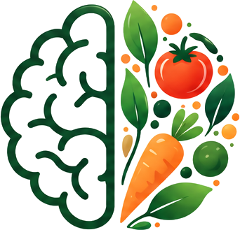

  

  <h1>🥗 NutriSense</h1>
  <h3>Nutrition That Makes Sense.</h3>
  
<strong>Confused about what to eat, how much to eat, or whether your meals support your goals?</strong> 
  Don't worry. We've got you. NutriSense brings food intelligence, personalized nutrition, and everyday consistency together — in one place.

  

    
    
    
    
    
  

  

    
  

  

    <a href="#-what-you-can-do">Explore Features</a> ·
    <a href="#-how-it-works">How It Works</a> ·
    <a href="#-getting-started">Get Started</a> ·
    <a href="#-project-structure">Project Structure</a>
  

  <em>Understand your food. Make informed choices. Build a healthier routine — one meal at a time.</em>

---

## 🌐 Try NutriSense

Curious to see it in action? Explore the deployed application:

  

  
<a href="https://nutri-sense-teal.vercel.app/"><strong>https://nutri-sense-teal.vercel.app/</strong></a>

---

## 🌱 The idea behind NutriSense

Healthy eating shouldn't feel like solving a puzzle.

Between calorie counting, confusing nutrition labels, meal decisions, dietary preferences, and tracking progress, staying consistent can get overwhelming. **NutriSense makes that journey easier to understand and easier to manage.**

NutriSense is an AI-powered nutrition platform that helps you:

- 📸 **Understand your plate** with AI-assisted food recognition.
- 🔎 **Look up food** using nutrition data from trusted food sources.
- 🎯 **Know your targets** with profile-based calorie and macronutrient calculations.
- 🍱 **Plan meals** around your goals and dietary preferences.
- 📊 **Track what you eat** and see how it fits into your day.
- 🤖 **Ask for meal ideas** in natural language with NutriSense AI.
- 🔥 **Build consistency** with progress summaries and streaks.

> **The NutriSense principle:** AI can help understand your food — but nutrition numbers should come from food data, not imagination.

## ✨ What you can do

<table>
<tr>
<td width="50%" valign="top">

### 📷 AI food scanning
Snap or upload a food image and get likely food matches with confidence information.

- Image-based food identification
- Candidate resolution against the food library
- Pluggable vision providers
- Trained EfficientNet-B0 model option

</td>
<td width="50%" valign="top">

### 🤖 NutriSense AI
Have a natural-language conversation about meal ideas.

- Ask for meals around a calorie target
- Use ingredients you already have
- Request high-protein or preference-led ideas
- Suggestions grounded in NutriSense food and nutrition services

</td>
</tr>
<tr>
<td width="50%" valign="top">

### 🔎 Food search & nutrition
Find foods and inspect their nutrition profile.

- Search common foods and ingredients
- USDA FoodData Central integration
- Open Food Facts integration for packaged products
- Serving-aware nutrition calculations

</td>
<td width="50%" valign="top">

### 🎯 Personalized targets
Turn profile information into useful daily nutrition goals.

- Age, height, weight and activity context
- Goal-aware calorie targets
- Protein, carbohydrate and fat targets
- Recalculation when profile details change

</td>
</tr>
<tr>
<td width="50%" valign="top">

### 🍱 Meal planning
Make meal decisions before hunger makes them for you.

- Goal-aware meal plans
- Dietary preference and allergy awareness
- Meal swaps and custom food entries
- Planning kept separate from actual food logs

</td>
<td width="50%" valign="top">

### 📊 Tracking & progress
See the bigger picture, not just one meal.

- Daily calories and macronutrients
- Fiber, sugar and sodium tracking
- Progress summaries across 7, 30 and 90 days
- Streaks and consistency insights

</td>
</tr>
</table>

### More than a calorie counter

| From... | To... |
|---|---|
| “What is this food?” | AI-assisted food identification |
| “How nutritious is it?” | Nutrition information from food-data providers |
| “What should I eat?” | Goal-aware meal suggestions and planning |
| “Am I on track?” | Daily tracking and progress summaries |
| “How do I stay consistent?” | Streaks and practical insights |

---

## 🧭 How it works

A simple experience on the surface, with clearly separated responsibilities underneath.

~~~mermaid
flowchart TD
    U([User]) --> UI[Web Experience]
    UI --> AUTH[Authentication & Profile]
    UI --> FOOD[Food Search]
    UI --> SCAN[AI Food Scan]
    UI --> PLAN[Meal Planning]
    UI --> TRACK[Daily Tracking & Progress]
    UI --> CHAT[NutriSense AI]

    FOOD --> FS[Food Service]
    SCAN --> VS[Vision Service]
    VS --> VM[Vision Provider]
    VM --> EFF[EfficientNet-B0]
    VM --> GEM[Gemini / OpenRouter]

    FS --> FD[Food Data Providers]
    FD --> USDA[USDA FoodData Central]
    FD --> OFF[Open Food Facts]
    FD --> LOCAL[Local Food Library]

    CHAT --> GEMINI[Gemini Intent Understanding]
    GEMINI --> NS[NutriSense Services]
    NS --> FD

    PLAN --> SERVICES[Domain Services]
    TRACK --> SERVICES
    AUTH --> SERVICES
    SERVICES --> REPO[Repositories]
    REPO --> DB[(SQLite / PostgreSQL)]

    classDef user fill:#dcfce7,stroke:#15803d,color:#14532d
    classDef ai fill:#ede9fe,stroke:#7c3aed,color:#4c1d95
    classDef data fill:#dbeafe,stroke:#2563eb,color:#1e3a8a
    class U user
    class VM,GEM,GEMINI ai
    class USDA,OFF,LOCAL,DB data
~~~

### 🧠 A closer look at the food-scanning pipeline

**Food identification is not the same as nutrition calculation.** NutriSense keeps those jobs separate:

~~~text
       Food Image
           |
           v
     Vision Provider
           |
           v
  Predicted Food Labels
   + Confidence Scores
           |
           v
     Food Resolution
           |
           v
   Verified Food Record
           |
           v
  Nutrition Calculation
           |
           v
    Nutrition Results
~~~

The vision layer can use a locally trained model or configured AI providers. Food and nutrition services resolve identified foods and calculate values from available food records.

### 🤖 How NutriSense AI stays grounded

~~~text
User: "Suggest a high-protein dinner"
                 |
                 v
       Gemini / Intent Parser
                 |
                 v
       Structured Meal Intent
                 |
                 v
       NutriSense Food Services
                 |
                 v
      Verified Food & Nutrition Data
                 |
                 v
       Context-aware Meal Suggestion
~~~

Gemini helps interpret the request and phrase the response. It is **not treated as the source of nutrition facts**. The application uses its own food and nutrition services for the underlying values.

---

## 🧪 AI & intelligence

### Food classification

| Component | Implementation |
|---|---|
| Model architecture | EfficientNet-B0 |
| Framework | PyTorch |
| Supported classes | 66 food categories |
| Image processing | Pillow + Torchvision transforms |
| Output | Food label and confidence |
| Model weights | Loaded locally at runtime |

The class mapping is maintained in **apps/api/app/providers/vision/models/class_to_idx.json**.

Model checkpoint files are intentionally not committed to the repository. Configure the model path and provide the checkpoint separately when using the trained-model provider.

### Provider-based design

The backend uses provider interfaces so integrations can change without rewriting domain services.

| Capability | Providers / sources |
|---|---|
| Food identification | Trained model, Gemini, OpenRouter, stub provider |
| Food information | Local food library, USDA FoodData Central, Open Food Facts |
| Conversational understanding | Google Gemini, with deterministic intent-parsing fallback |

---

## 🧰 Tech stack

| Layer | Technologies |
|:---|:---|
| **Production web app** | Next.js 15, React 19, TypeScript |
| **UI & styling** | Tailwind CSS 4 |
| **Client data & state** | TanStack Query, Zustand |
| **Forms & validation** | React Hook Form, Zod |
| **Backend API** | Python, FastAPI, Pydantic |
| **Data access** | SQLAlchemy, Alembic |
| **Database** | SQLite for local development, PostgreSQL-ready |
| **Computer vision** | PyTorch, Torchvision, EfficientNet-B0, Pillow |
| **Generative AI** | Google Gemini, OpenRouter vision provider |
| **Nutrition data** | USDA FoodData Central, Open Food Facts |
| **Testing** | Pytest, Vitest, Playwright |
| **Design prototype** | React, Vite 8, TypeScript, Tailwind CSS 4 |

---

## 🏗️ Project structure

NutriSense is organized as a monorepo. The production application is split into a web frontend and a modular FastAPI backend. The root-level Vite app is retained as a clickable design prototype.

~~~text
NutriSense/
|
├── apps/
│   ├── web/                         # Next.js production frontend
│   │   └── src/
│   │       ├── app/                 # App Router pages and layouts
│   │       ├── components/          # Shared UI components
│   │       ├── features/            # Feature-oriented modules
│   │       └── lib/                 # API client and utilities
│   │
│   └── api/                         # FastAPI backend
│       └── app/
│           ├── api/v1/routes/       # Versioned REST endpoints
│           ├── core/                # Config, security, exceptions
│           ├── db/                  # Database and seed setup
│           ├── models/              # SQLAlchemy models
│           ├── providers/           # Vision and food-data integrations
│           ├── repositories/        # Persistence operations
│           ├── schemas/             # Pydantic contracts
│           └── services/            # Business logic
│
├── docs/                            # Architecture and design docs
├── src/                             # Clickable Vite prototype
├── index.html
├── vite.config.ts
├── package.json
└── README.md
~~~

### Backend design

NutriSense follows a **modular monolith** architecture — not a collection of microservices.

~~~mermaid
flowchart LR
    R[API Routes] --> S[Domain Services]
    S --> P[Providers]
    S --> Q[Repositories]
    Q --> D[(Database)]
    P --> X[External APIs / ML Models]
~~~

- **Routes** validate requests and delegate work.
- **Services** own business rules and use cases.
- **Repositories** own database access.
- **Providers** own external API and model interactions.
- **Schemas** define the API contracts.

This keeps business logic out of route handlers and UI pages, and makes integrations easier to test and replace.

---

## 🚀 Getting started

There are three runnable parts in the repository: the root prototype, the production web app, and the API.

### Prerequisites

- Node.js (use the version specified in **.mise.toml**)
- pnpm
- Python 3.11+
- Git

### 1. Clone the repository

~~~bash
git clone https://github.com/shaheeq27/NutriSense.git
cd NutriSense
~~~

### 2. Run the root Vite prototype

From the repository root:

~~~bash
pnpm install
pnpm dev
~~~

### 3. Run the FastAPI backend

~~~bash
cd apps/api
python -m venv .venv
source .venv/bin/activate
pip install -e ".[dev]"
~~~

Create **apps/api/.env** and configure the values you need:

~~~env
ENV=development
DATABASE_URL=sqlite:///./nutrisense.db
JWT_SECRET=replace-with-a-long-random-secret
CORS_ORIGINS=http://localhost:3001

# Optional integrations
USDA_API_KEY=
FOOD_PROVIDER=local

GEMINI_API_KEY=
GEMINI_MODEL=gemini-3.5-flash

OPENROUTER_API_KEY=
OPENROUTER_VISION_MODEL=google/gemma-4-31b-it:free

# stub | gemini | trained_model
VISION_PROVIDER=stub
TRAINED_MODEL_PATH=app/providers/vision/models/best_model.pth
~~~

Start the API:

~~~bash
uvicorn app.main:app --reload
~~~

The API runs locally at **http://localhost:8000**. Interactive API documentation is available at **http://localhost:8000/docs**.

### 4. Run the production Next.js frontend

In a separate terminal:

~~~bash
cd apps/web
pnpm install
pnpm dev
~~~

The web app's local development port is configured by Next.js; check the terminal output for the exact local URL.

> **Security note:** Never commit real API keys, database credentials, JWT secrets, model checkpoints, or local environment files.

---

## ⚙️ Configuration at a glance

| Variable | Purpose |
|---|---|
| **DATABASE_URL** | Database connection string |
| **JWT_SECRET** | Secret used to sign authentication tokens |
| **CORS_ORIGINS** | Allowed frontend origins |
| **USDA_API_KEY** | Enables USDA FoodData Central access |
| **FOOD_PROVIDER** | Selects the configured food-data provider |
| **GEMINI_API_KEY** | Enables Gemini-powered features |
| **GEMINI_MODEL** | Gemini model identifier |
| **OPENROUTER_API_KEY** | Enables the OpenRouter vision provider |
| **OPENROUTER_VISION_MODEL** | OpenRouter vision model identifier |
| **VISION_PROVIDER** | Selects the primary vision provider |
| **TRAINED_MODEL_PATH** | Location of the local model checkpoint |

Optional providers require their corresponding credentials and configuration. The local food library and stub vision provider are available for development without external AI credentials.

---

## 🧪 Quality & testing

The repository includes automated tests and tooling for the API and web application.

**API**
~~~bash
cd apps/api
pytest
~~~

**Web application**
~~~bash
cd apps/web
pnpm test
pnpm typecheck
pnpm build
~~~

**Root prototype**
~~~bash
# From the repository root
pnpm build
~~~

---

## 🗺️ Product areas

| Area | What it covers |
|---|---|
| Public food tools | Food search, image analysis, nutrition results and BMI |
| Authentication | Registration, login and JWT-based access |
| Onboarding & profile | User details, goals and dietary context |
| Dashboard & today | Daily nutrition overview |
| Meal planning | Plan generation, meal swaps and custom entries |
| Tracking | Actual daily food logs |
| Progress | Historical summaries and consistency |
| AI assistant | Natural-language meal requests |

For detailed domain boundaries and request flow, see **[docs/architecture.md](docs/architecture.md)**.

---

## 💚 What makes NutriSense different?

- **AI with guardrails:** AI helps interpret and identify; nutrition values are resolved through food-data services.
- **Personalized, not one-size-fits-all:** Targets and suggestions can account for user profile, goals, preferences and allergies.
- **Planning is not tracking:** A planned meal is not automatically counted as something eaten.
- **Replaceable integrations:** Vision and food-data providers sit behind dedicated interfaces.
- **A maintainable backend:** Routes, services, repositories and providers have clear responsibilities.
- **Consistency over perfection:** The product encourages sustainable habits rather than obsessing over a single meal.

> *A healthier routine isn't built in one perfect day. It's built through small, informed choices repeated over time.*

---

## 🔭 Roadmap

The project is under active development. Areas for continued improvement include:

- [ ] Expand food recognition coverage and evaluate model performance
- [ ] Improve scan confidence handling and user correction flows
- [ ] Extend nutrition-data coverage and provider resilience
- [ ] Add richer meal-planning controls and personalization
- [ ] Improve analytics and long-term progress insights
- [ ] Strengthen deployment, observability and end-to-end testing

---

## 🤝 Contributing

Ideas, bug reports and thoughtful contributions are welcome.

1. Fork the repository.
2. Create a feature branch: **feat/your-feature**.
3. Make your changes and add or update tests.
4. Run the relevant checks.
5. Open a pull request with a clear description and screenshots for UI changes.

Please avoid committing secrets, user data, or model weight files.

---

## 👨‍💻 Built by

  <h3>Shaheeq Shaik</h3>
  
Building at the intersection of AI, machine learning, and full-stack product engineering.

  

    

  <h2>🥗 NutriSense</h2>
  <strong>Nutrition That Makes Sense.</strong>
  
<em>Understand your food. Build your better day.</em>

